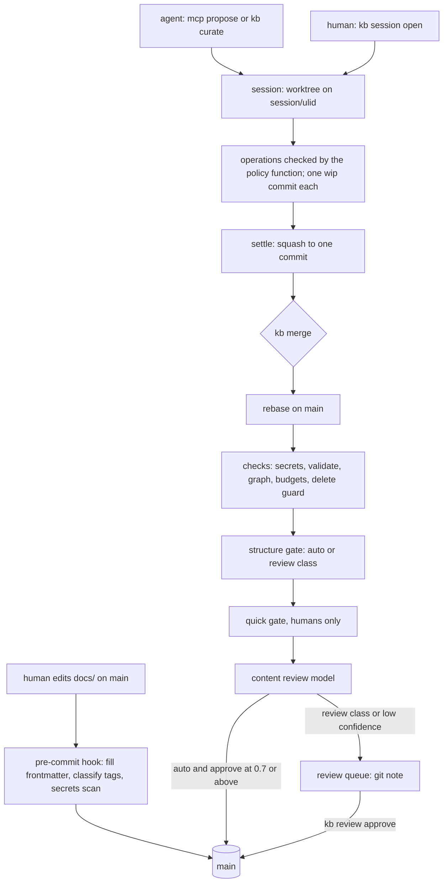
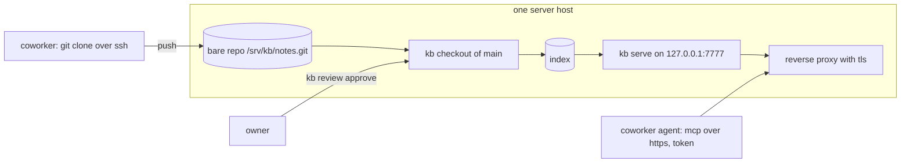

# kb audit, verification, and deploy guide

date: 2026-09-28. scope: [design.md](design.md), the `kb/` crate at commit `307d84d`, and the live instance at `~/2_resources/notes`. nothing was changed in the crate or the live instance. reproductions ran in throwaway repositories under `.tmp/audit_*/`.

| part | content |
|---|---|
| [1](#1-verdict) | verdict |
| [2](#2-how-the-system-works) | how the system works |
| [3](#3-is-it-solving-the-right-problem) | is it solving the right problem |
| [4](#4-findings) | findings, ranked by when they must be fixed |
| [5](#5-design-claims-that-the-code-does-not-meet) | design claims the code does not meet |
| [6](#6-the-core-profile) | the core profile: what to run for the test, what to turn off |
| [7](#7-verification-guide) | verification guide |
| [8](#8-deploy-guide) | deploy guide: local, then local network |
| [appendix](#appendix-terms) | terms |

---

## 1. verdict

- **the core is sound.** plain markdown in git, frontmatter filled on commit, sqlite search with full text plus vectors, cited answers, and an [mcp](#appendix-terms) interface for agents. `main` only moves forward: no code path force-pushes or resets it. 398 tests pass, 6 ignored (live providers), 0 clippy warnings.
- **the governance layer is built for a corpus that does not exist yet.** layers, criticality, supersession, and nightly auto-fixes do not engage with the live notes (section 3).
- **it is not ready for daily use as deployed.** 8 defects lose files, leak note content, or land agent changes with no person checking. 3 of them (P0-3, P0-4, P0-5) affect the live instance today (section 4, P0).
- **it is not ready for a local network server.** any token holder can read any file on the host, 8 requests hang the server, and `access.read` is not enforced (section 4, P1).
- **recommendation:** fix the 8 P0 items, run the core profile (section 6) for two weeks against the measures in section 7.3, then fix P1 and open a read-only server to coworkers before opening writes.

## 2. how the system works

### 2.1 stores

| store | what it holds | truth or derived |
|---|---|---|
| git repository | `docs/<ulid>.md` (toml frontmatter plus markdown body), config, prompts | truth |
| content store `.kb/store/` | captures (gathered context such as files or slack threads) by sha256 | truth for captures |
| state database `.kb/state.sqlite` | capture catalog, sessions, tokens, usage, backup manifest | operational state |
| index `.kb/index/<commit>.sqlite` | chunks, full-text index, vectors, refs, graph metrics, one file per `main` commit | derived, rebuildable |
| run logs `.kb/runs/<ulid>.sqlite` | every agent action, hash-chained | audit record |

### 2.2 write path



- a human has two paths. a commit on `main` runs only the pre-commit hook. a session runs the full merge.
- an agent has one path: a session. the policy function decides which [operations](#appendix-terms) (create, append, revise, and 8 others) it may apply to which documents.
- the structure gate classes a change `auto` or `review` from what it touches: policy fields, critical sections, locked layers.
- content review asks a model (sonnet in the live config) for approve, request changes, or escalate.

### 2.3 read path

1. `kb tick` (every 60 seconds) builds an index for the newest `main` commit.
2. `search` fuses bm25 full-text ranks with vector ranks ([reciprocal rank fusion](#appendix-terms)) and returns the top 5 documents.
3. `answer` sends those passages to the answer model and keeps only citations that point at passages it was given.
4. `get` returns frontmatter, derived data (last updated, contributors, criticality), and body.

### 2.4 background jobs (live systemd user timers)

| timer | schedule | action |
|---|---|---|
| `kb-tick@notes` | 60 s | index `main`; repair stuck sessions and orphan worktrees |
| `kb-capture` | hourly | pull configured sources into the content store |
| `kb-eod` | 02:00 | settle every open session, then merge every settled session |
| `kb-nightly` | 03:00 | find duplicates, stale and orphan documents, broken refs; escalate; auto-fix only above 50 canon documents |
| `kb-backup` | hourly | incremental git bundle |
| `kb-backup-full` | 04:00 | full bundle (fails every run, see P0-4) |

## 3. is it solving the right problem

### 3.1 what the live instance shows

| measure | value |
|---|---|
| documents | 71 (65,090 words; median 491, max 6,454) |
| layers in use | 1 (`reference`, all 71) |
| `canon` documents | 0 (all 71 are `draft`) |
| commits since the 2026-09-22 import | 0 |
| sessions opened since the import | 0 |
| agent proposals | 0 |
| nightly escalations | 42: the same 14 duplicate pairs, filed again on each of 3 runs |
| titles that are `TODO` | 8; 2 more are a table row, `\| port 4 \|` |
| provider calls saved as claude transcripts | 126 files, each holding a full note body |

the corpus is working notes: daily task lists, meeting notes, plans, and reports. it is not a hierarchy of principles, designs, and decisions.

### 3.2 which mechanisms engage with this corpus

| engages today | inert today, and why |
|---|---|
| frontmatter fill, ulid filenames, import | layers and `agent_policy`: one layer, all `editable` |
| secrets gate | critical sections: `reference` has none |
| full-text and vector search, `answer` | criticality band: undefined below 50 canon documents |
| mcp `search`, `get`, `answer` | supersede, retire, forward pointers, delete guard: no canon documents |
| duplicate detection (as noise, 3.1) | nightly auto-fix: needs 50 canon documents |
| backups (hourly only) | quick gate: runs only in the session path, which is unused |

### 3.3 conclusion

- the problem worth validating first: **can you and your agents find and reuse what you wrote, and can an agent add to it without damage.** the core mechanisms answer that.
- the governance layer answers a later problem: many writers and many agents changing a shared canon. it accounts for most of the defects in section 4, while doing nothing on this corpus.
- 0 commits in 6 days suggests the write path has too much friction, or nothing prompts its use. the test in section 7.3 measures this directly.
- the design assumes humans set `status = canon` and choose layers. working notes never get either. two options:
  - accept that notes stay `draft`, and point canon mechanisms only at documents a person promotes.
  - drop `draft` as a default status for human notes.
- the `draft past ttl` rule proposes deleting any draft untouched for 30 days. on this corpus, that means ordinary notes.

## 4. findings

- **P0:** fix before the local daily-use test.
- **P1:** fix before other people use the server.
- **P2:** design gaps that can wait.
- "repro" means the audit reproduced the failure with the release binary. "code" means it was confirmed by reading the code only.

### 4.1 P0: before the local test

| id | finding | where | failure | evidence |
|---|---|---|---|---|
| P0-1 | tick removes any git worktree whose path contains `worktrees` and has no `session/<name>` branch, with `--force` | [tick.rs:80](kb/src/merge/tick.rs:80) | a worktree under `.claude/worktrees/`, where your global instructions put agent worktrees, is deleted with its uncommitted files within 60 s | repro |
| P0-2 | landing, `abandon`, and `cleanup` run `git worktree remove --force` | [session/mod.rs:472](kb/src/session/mod.rs:472), [git.rs:234](kb/src/git.rs:234) | a file created in a session after settle is destroyed and exists on no branch | repro |
| P0-3 | the pre-commit hook re-stages with `git add -A -- docs/` | [cli/check.rs:77](kb/src/cli/check.rs:77) | an untracked, half-written `docs/scratch.md` is committed with an unrelated note and never validated | repro (this audit) |
| P0-4 | the daily full backup passes `--kind full`; the cli accepts `bundle-full` | [schedule/mod.rs:178](kb/src/schedule/mod.rs:178), [:341](kb/src/schedule/mod.rs:341) | failed on every run since 2026-09-23 (journald). after 7 days the incremental chain has a gap, and a restore from bundles fails | repro (live) |
| P0-5 | the `claude-code` provider does not pass `--no-session-persistence` | [claude_code.rs:59](kb/src/provider/claude_code.rs:59) | 126 transcripts in `~/.claude/projects/-home-calebbarzee-2-resources-notes/` hold full note bodies and review packets, and appear as sessions in the desktop app. on a server, every coworker's notes would land in your claude history | repro (live) |
| P0-6 | session base is not updated after `kb merge` rebases | [merge/mod.rs:143](kb/src/merge/mod.rs:143), [session/mod.rs:454](kb/src/session/mod.rs:454), [merge/mod.rs:730](kb/src/merge/mod.rs:730) | after any failed or `--check` merge, re-settling absorbs other sessions' landed changes. repro: a `kb revert` was undone by an unrelated session that landed as auto class | repro |
| P0-7 | agent writes can reach files outside `docs/` and land as auto class | [ops.rs:90](kb/src/curate/ops.rs:90), [merge/mod.rs:652](kb/src/merge/mod.rs:652), [cli/curate.rs:96](kb/src/cli/curate.rs:96) | `target_id = "../prompts/style"` appended text to `prompts/style.md`, which is prepended to every model prompt, including review. `groups.toml` and `kb.toml` edits (raise the layer ceiling, allow all paths past the secrets gate) also landed as auto | repro |
| P0-8 | agent changes can land with no human check | [review/content.rs:101](kb/src/review/content.rs:101), [merge/mod.rs:266](kb/src/merge/mod.rs:266), [schedule/mod.rs:114](kb/src/schedule/mod.rs:114) | approve at 0.95 with an `injection` finding merged. with no review provider, agent sessions merge unreviewed and log no review event. the 02:00 eod script merges every settled session, including agent and nightly ones | repro |

the fix for P0-7 and P0-8 during the test is one rule: **every agent session is review class, and any path outside `docs/*.md` is review class.** auto-merge for agents waits for the review evaluation gate in design §31.

### 4.2 P1: before the local network server

| id | finding | where | failure | evidence |
|---|---|---|---|---|
| P1-1 | `/blob/<sha>` joins the decoded path segment without checking for 64 hex characters | [rest.rs:55](kb/src/server/rest.rs:55), [blob.rs:37](kb/src/store/blob.rs:37) | `GET /blob/%2Fetc%2Fhostname` returns the file. any token holder reads `state.sqlite`, `kb.toml`, `~/.ssh` | repro |
| P1-2 | a multibyte character in `/blob/` panics a worker thread; there is no `catch_unwind` | [blob.rs:37](kb/src/store/blob.rs:37), [server/mod.rs:174](kb/src/server/mod.rs:174) | 8 requests hang the server; the process stays up, so systemd never restarts it | repro |
| P1-3 | `access.read` is not enforced on search, get, refs, docs, captures, or blobs | [handlers.rs:399](kb/src/server/handlers.rs:399), [build.rs:26](kb/src/index/build.rs:26) | a token with no groups read a document restricted to `secret-team`, and every capture | repro |
| P1-4 | `--no-auth` has no origin, host, or content-type check | [rest.rs](kb/src/server/rest.rs), [schedule/mod.rs:189](kb/src/schedule/mod.rs:189) | a web page can post to `/propose` (opens a session and commits) and `/webhook/*`; dns rebinding can read `/search` and `/blob` | repro (curl) |
| P1-5 | no tls; no request body limit | [server/mod.rs:81](kb/src/server/mod.rs:81), [rest.rs:268](kb/src/server/rest.rs:268) | bearer tokens cross the network in clear text; a 50 MB body is stored as a capture | repro |
| P1-6 | `kb token revoke` matches `LIKE target%` on hash or principal; `issue` accepts unknown principals | [auth.rs:318](kb/src/server/auth.rs:318) | `revoke a` revoked another user's token; `revoke ''` revoked all 20 | repro |
| P1-7 | human commits to `main` bypass every merge check | [cli/init.rs:109](kb/src/cli/init.rs:109) | a `git rm` of a canon document committed directly and landed; `--no-verify` skips the hook. acceptable for one owner; with several writers it needs a server-side check | repro |
| P1-8 | `kb merge --approve` lands review class and overrides `request_changes` with no approval note or write-group check; `review approve` approves the current head, not the reviewed commit | [cli/merge.rs:22](kb/src/cli/merge.rs:22), [merge/mod.rs:914](kb/src/merge/mod.rs:914) | any shell agent can self-approve | repro |
| P1-9 | merge never calls `policy::decide`; the gate matches critical sections only at the top level and ignores `status`, `parent`, `[structure]` | [gate.rs:46](kb/src/check/gate.rs:46), [gate.rs:106](kb/src/check/gate.rs:106) | a `rollback` section under an `# title` heading changes as auto; an agent can promote `draft` to `canon` or remove supersession as auto | repro |
| P1-10 | merge secrets scan diffs `base..head`, so it sees only the net change | [secrets.rs:117](kb/src/check/secrets.rs:117) | a wip commit adding an aws key and a later wip commit removing it land on `main` with the key in history, because merge does not require a settled session | repro |
| P1-11 | tick builds `HEAD`, not `main`; the newest artifact is chosen by file mtime | [tick.rs:28](kb/src/merge/tick.rs:28), [build.rs:174](kb/src/index/build.rs:174) | with a branch checked out, search serves unmerged text, and keeps serving it after switching back | repro |
| P1-12 | rest and mcp `search` return 500 when the embed provider is down; a build during an outage stores no vectors for that commit and caches fallback prefixes permanently | [handlers.rs:403](kb/src/server/handlers.rs:403), [prefix.rs:127](kb/src/index/prefix.rs:127) | ollama restart breaks agent search | repro |
| P1-13 | `state.sqlite` is never backed up; all backups sit on the same disk (`~/3_archives`) | [backup/mod.rs](kb/src/backup/mod.rs) | disk loss loses everything; `state.sqlite` loss orphans the capture catalog and tokens | code, live config |
| P1-14 | import re-run duplicates every note; same filename in two folders links to the wrong one; `[[x\|alias]]` and `[[x#section]]` lose parts; links in code blocks are rewritten | [import/mod.rs:159](kb/src/import/mod.rs:159), [:302](kb/src/import/mod.rs:302) | coworkers importing their notes get wrong links | repro |
| P1-15 | `kb eod` stops at the first failing session (an empty session is enough); a session settled once is never swept again | [session/mod.rs:520](kb/src/session/mod.rs:520) | later sessions keep uncommitted work overnight | repro |
| P1-16 | nightly files the same escalation again each run | [maintain/mod.rs](kb/src/maintain/mod.rs) | 42 files for 14 findings after 3 runs; the queue becomes unreadable | repro (live) |
| P1-17 | settle and merge block on secrets warnings; the aws rule matches 40-hex git shas near the word `aws` | [session/mod.rs:407](kb/src/session/mod.rs:407), [merge/mod.rs:448](kb/src/merge/mod.rs:448) | ordinary engineering notes are hard-blocked, which breaks invariant 2 | repro |
| P1-18 | `kb init` inside an existing git repository attaches to the parent repository | [cli/init.rs](kb/src/cli/init.rs) | `kb session open` created a branch and worktree in the parent repository; config files are left untracked | repro (this audit) |
| P1-19 | title fill takes the first heading anywhere in the body | [validate.rs](kb/src/check/validate.rs) | 8 notes titled `TODO`, 2 titled `\| port 4 \|`; search results are hard to tell apart | live |

### 4.3 P2: later

| finding | where |
|---|---|
| run log is not tamper-evident: keyless hash with the final hash in the same mutable row; `op` rows written after the file; curate and review log no `llm_request` or `llm_response` | [runlog/](kb/src/runlog/), [curate/mod.rs:365](kb/src/curate/mod.rs:365) |
| conflict packet labels "ours" and "theirs" backwards during a rebase | [merge/mod.rs:818](kb/src/merge/mod.rs:818) |
| nightly reads orphan and stale from `reads_90d`, which only `answer` records; above 50 canon documents it would retire unread canon | [findings.rs:195](kb/src/maintain/findings.rs:195) |
| nightly re-reviews human and human-approved merges for revert; `nightly.md` is never loaded; two identical review calls per commit | [findings.rs:676](kb/src/maintain/findings.rs:676) |
| criticality band exceeds 20 percent on ties: most notes score 0 and all become `low` | [criticality.rs](kb/src/index/criticality.rs) |
| sessions stuck in `merging` after an error; tick marks them settled after 10 minutes without checking for a running merge | [tick.rs:46](kb/src/merge/tick.rs:46) |
| a held index lock aborts the whole tick; a reused pid blocks builds | [build.rs:218](kb/src/index/build.rs:218) |
| `restore-drill` deletes its target directory without asking and compares only `main` shas | [backup/mod.rs:313](kb/src/backup/mod.rs:313) |
| units run `kb/target/release/kb` directly, so any `cargo build` replaces the deployed binary | [cli/schedule.rs:47](kb/src/cli/schedule.rs:47) |

### 4.4 status on 2026-10-02

| finding | state | commit |
|---|---|---|
| P0-1 tick removes foreign worktrees | fixed: only ulid-named worktrees under `.kb/worktrees/`; dirty ones are kept | `f9ef2e7` |
| P0-2 landing and abandon delete uncommitted files | fixed: removal refuses a dirty worktree; merge requires a clean, settled session | `f9ef2e7` |
| P0-3 hook stages unstaged files | fixed: re-stages only files validation rewrote | `fed558b` |
| P0-4 daily full backup kind | fixed in the unit text; the live units must be reinstalled | `fb89d83` |
| P0-5 provider calls saved as claude sessions | fixed: `--no-session-persistence`, neutral working directory | `8ad34f5` |
| P0-6 stale base after rebase | fixed: merge records the post-rebase base | `f9ef2e7` |
| P0-7 agent writes outside `docs/` | fixed: ulid targets only; non-doc paths are review class; `kb curate apply` runs policy | `bc1060a` |
| P0-8 agent changes merge unchecked | fixed: agent sessions are review class unless `agent_auto_merge = true`; injection findings force review; nightly delete and revert wait in the queue | `bc1060a` |
| P1-1, P1-2 blob traversal and worker panic | fixed | `2d77033` |
| P1-3 `access.read` not enforced | fixed for search, get, refs, docs, answer, blob when `groups.toml` lists principals | `2d77033` |
| P1-4 cross-site requests under `--no-auth` | fixed: loopback `Host` and `Origin`, json-only POST | `2d77033` |
| P1-5 tls; body limit | body limit fixed (10 MiB); tls stays a reverse proxy concern | `2d77033` |
| P1-15 eod stops at the first failing session | fixed | `f9ef2e7` |
| P1-18 `kb init` inside another repository | fixed | `fed558b` |
| read-only server for step 2a | added: `kb serve --read-only` | `e00f208` |
| new: classify failure blocks the commit | fixed: becomes a warning, defaults apply (design §6) | `6050def` |
| new: state written inside a session worktree is lost | fixed: `state_dir` resolves to the main repository | `c6e976d` |
| new: `kb --json curate` prints text before the json | fixed | `db62a13` |
| new: an append that adds a note's first heading reads as removing `_body`; the reviewer rejected it | fixed | `d3187bf` |
| new: an answer passage on a heading omits its subsections ("not in the knowledge base") | fixed | `da728dd` |
| P2 nightly reviews each commit twice | fixed | `5902ff6` |
| new: a section edit marks every enclosing section changed; the settle summary disagrees with the review packet | fixed | `365f850`, `2dfb381` |
| new: the agent cannot address `_preamble` or `_body`, so it rewrites or duplicates that text | fixed | `f4b13c8` |
| P1-16 and new: escalations repeat every night; agent escalations reach no queue | fixed: one open item per kind and document set; agent escalations are queued and shown in the next packet | `06a8d05` |
| new: nightly's review calls belong to no run | fixed | `9bee9d3` |
| new: a long settled subject cut mid-word reads as an unfinished sentence to the reviewer | fixed | `9d071a5` |
| transcripts of every model and mcp call | added: `transcripts` table, `kb transcript` | `6050def` |
| simulated time | added: `KB_NOW` | `ff1e67c` |

the remaining P1 items (6 to 14, 16, 17, 19) and every P2 item are open.

## 5. design claims that the code does not meet

[README.md](README.md) says steps 0 to 6 are implemented. these parts of design.md are missing or differ:

| design | state |
|---|---|
| §10 policy runs again inside `kb merge` | not called |
| §17.1 incremental index build | every build is full; `--full` has no effect (fine at 71 documents) |
| §19 guards: 20 documents or 30 percent per session; 50 operations or 30 minutes; prompt checksums at run start | config keys exist, never read |
| §16 log before act; final hash in the commit message | not met |
| §20 `kb redact`, `redactions/` records, run log scanning | not implemented |
| §21 litestream replication of `state.sqlite` | not implemented |
| §23 object store backend | not implemented |
| §12 eod removes worktrees idle 24 hours | abandons only sessions with 0 commits |
| §15.3 duplicates by 0.92 cosine | jaccard over 5-word shingles |
| §24 a commit on `main` opens a session | the hook only fills and scans |
| §11 `revise` on append-only is review | denied |

the design should be amended where the code is the better choice (for example, human commits on `main` are hook-checked only), and the rest listed as not built.

## 6. the core profile

run this for the two-week test. it keeps the mechanisms that section 3 found useful and removes the rest from the daily path, without deleting code.

| keep on | turn off for the test | how |
|---|---|---|
| hook on `main` commits (fill, classify, secrets) | quick gate | remove `[providers.gate]` from `kb.toml` |
| index, search, answer | conflict resolver model | remove `[providers.resolve]`; conflicts stop for you |
| mcp over stdio | eod merging agent sessions | agent sessions stay review class (P0-8 fix) |
| agent writes through `propose`, always review class | nightly auto-fix | already inert below 50 canon; keep nightly as report only |
| `kb review list` and `approve` | capture and curate | leave `[sources]` empty unless you test the inbox |
| hourly and daily bundles, mirror | `kb serve` | not needed locally; mcp over stdio covers agents |

code to consider removing after the test, if the measures in 7.3 do not need it: criticality and pagerank, `policy::classify` (duplicates the gate and its result is discarded), git notes as the review queue (a session state field covers it locally), the 5-retry remote push loop, and the resolver sub-run.

## 7. verification guide

### 7.1 static checks

```bash
cd ~/1_projects/dev/third_brain/kb && cargo test --release
```

```bash
cd ~/1_projects/dev/third_brain/kb && cargo clippy --release --all-targets -- -D warnings
```

expected: 0 failed, 0 warnings. baseline today: 398 passed, 6 ignored.

### 7.2 acceptance checks

run in a scratch knowledge base **outside any git repository** (P1-18). each check maps to a P0 fix and must pass before redeploying. set up once:

```bash
export B=~/1_projects/dev/third_brain/kb/target/release/kb V=/tmp/kb_verify && rm -rf $V && $B init $V && cd $V && git add -A && git commit -qm init
```

| id | check | commands | pass when |
|---|---|---|---|
| V1 | tick leaves foreign worktrees alone (P0-1) | `git worktree add .claude/worktrees/x -b x && echo keep > .claude/worktrees/x/f && $B tick` | `.claude/worktrees/x/f` exists |
| V2 | landing keeps uncommitted work (P0-2) | open a session, add a note, settle, then create `docs/late.md` in the worktree, `$B merge <id>` | merge refuses and names `docs/late.md`, or keeps the worktree |
| V3 | hook commits only what you staged (P0-3) | `git add docs/a.md`, leave `docs/scratch.md` untracked, `git commit -m a` | `git show --stat HEAD` lists one note; `scratch.md` still untracked |
| V4 | full backup kind (P0-4) | `$B schedule install --dry-run \| grep 'backup run'` | prints `--kind bundle-full`; `$B backup run --kind bundle-full` exits 0 with a `backup.toml` |
| V5 | no provider transcripts (P0-5) | count files in `~/.claude/projects/-tmp-kb-verify/`, run `$B provider test classify` with a `claude-code` classify role, count again | count unchanged |
| V6 | re-settle after a failed merge (P0-6) | S1 edits note A; S2 edits note C and lands; `$B merge S1 --check`; `$B session settle S1`; `$B revert S2`; `$B merge S1` | note C keeps its reverted text; S1's commit lists only note A |
| V7 | agent cannot leave `docs/` (P0-7) | `$B curate apply --session <id> --ops-json ops.json` with `[{"op":"append","target_id":"../prompts/style","content":"x","justification":"test"}]` | refused; `prompts/style.md` unchanged |
| V8 | agent sessions wait for you (P0-8) | `$B curate propose "a fact" --task "add"`, then `$B merge <id>`, then `$B eod` and `$B merge <id>` again, as the 02:00 script does | merge reports review class; `$B review list` shows it; `main` unchanged until `$B review approve <id>` |
| V9 | core flow | write three notes on `main`; `$B tick`; `$B search <word>`; `$B answer ask "<question>"` | each note is found within one tick; every citation resolves to a given passage |
| V10 | restore | `$B backup run --kind all`; `$B backup verify`; `$B backup restore-drill /tmp/kb_drill_empty` | verify passes; drill reports no differences |

the long-form scenarios in [verification_prompt.md](verification_prompt.md) remain valid for the P1 and P2 items. run its parts 2 and 4 before the network server.

### 7.3 two-week field test

the question from section 3.3, answered with measures. record each daily in a note in the knowledge base itself.

| measure | how to read it | target |
|---|---|---|
| notes written or edited per workday | `git log --since=1.day --oneline -- docs/ \| wc -l` | at least 1; below that, the write path has too much friction |
| searches and answers per workday | `usage` rows in `.kb/state.sqlite` (needs `sqlite3`, not installed today) | at least 3 |
| answer citation accuracy | mark each answer right or wrong in the daily note | 90 percent of cited passages support the claim |
| retrieval quality | `kb answer eval-seed` writes title-based queries to `eval/queries.toml`; replace them with 30 real questions and expected ids; then `kb answer eval --compare fts,hybrid` | hybrid mrr above full-text by 0.02 (design §31) |
| agent proposals approved without edits | approvals in `kb review list` against later edits in `git log` | informs whether auto-merge is worth building; design gate is 80 percent |
| data loss or surprise commits | any file lost or committed without intent | 0 |
| backup health | `systemctl --user --failed` | empty every day |

at the end, decide from the numbers which of the section 6 "off" mechanisms to turn on, keep off, or delete.

### 7.4 simulation results, 2026-10-02

`kb/scripts/simulate.py` ran 12 simulated days (2026-10-05 to 2026-11-08, three days apart) on a copy of 12 fixture notes, with live models: classify, review, and answer on haiku, curate on sonnet, embeddings on `nomic-embed-text`.

- **each day:** a human note and a hand edit on `main`, a captured meeting note curated by the agent, two agent rewrites of the same notes, three fixed questions, then eod, nightly, and a full backup under the simulated clock.
- **approvals:** a simulated person approved every agent change the reviewer did not reject. this is the worst case for drift: nothing a person would catch is caught.
- **files:** the full text of every command, landed diff, review verdict, and answer is in `.tmp/sim_12gen_2026-10-02f/simulation.log`. per-note metrics are in `metrics.tsv` and `report.md`, and note snapshots are in `gen_00/` to `gen_12/`.

| measure | result |
|---|---|
| acceptance checks V1, V3, V4, V7, V10 | 5 of 5 pass |
| agent sessions landed / rejected by the reviewer / empty | 27 / 6 / 1 |
| model calls, errors | 256, 0 |
| claude session files created | 0 |
| wall time | 2 h 14 min (11 min per simulated day) |
| review calls: share of model time, mean duration, mean output tokens | 81 percent, 50 s, 5,135 |
| facts kept (ip addresses, measurements, versions, pins, command and code lines) | 517 of 518 after 12 days; the one miss is a wrapped `docker buildx` command joined onto one line, intact in the text |
| most rewritten note (`static_ip`, 12 rewrites) | 255 to 394 words, similarity to day 0 of 0.23, 17 of 17 facts kept, lexical diversity 0.376 to 0.350 |
| answers with a dropped citation | 1 of 36 |
| notes deleted | 0; 18 draft-past-ttl findings became escalations |

what the text shows, read in the log and the snapshots:

- **no drift into vagueness.** rewrites added headings, fenced commands, and numbered steps; generic phrases stayed at 0 in every note. growth came from curated facts, for example the laptop address and the wall port label.
- **contradictions were kept and flagged, not resolved.** the agent marked the 192.168.50.1 versus .20 laptop address conflict in generation 1 and carried it through 11 more rewrites without picking a side.
- **the agent asked the same question 10 times.** its escalations went only to the run log. fixed after this run (`06a8d05`): escalations go to the queue once, and the next packet shows them.
- **answers improved with the notes.** the port 4 answer moved from 16 dB to the curated 13 dB after the cable swap, citing both. the static ip answer cites a daily note before the guide and answers only the first half of the question.
- **one meaning change:** "if we ever split jobs across machines" became "if jobs are split across machines".
- **the reviewer is strict.** of 6 rejections, 1 caught real duplication. the rest objected to justifications that did not match the diff. two causes of false rejections were fixed during the runs (`d3187bf`, `2dfb381`), and a third (whitespace claims) by a prompt change (`bb56d64`).

runs b to e were stopped early because each exposed a bug, fixed before the next run; section 4.4 lists them.

a 4-day confirmation run (`.tmp/sim_confirm_2026-10-02g/`) used the binary with every fix up to `06a8d05`:

| measure | result |
|---|---|
| acceptance checks | 5 of 5 pass |
| agent sessions landed / rejected / empty | 8 / 3 / 1 |
| the address conflict, filed to the escalation queue | once in 4 days (run f: 10 times in 12) |
| model calls with no run | 21, all pre-commit classify (run f: 92) |
| facts kept | 518 of 518 |
| claude session files created | 0 |

all 3 rejections objected to the cut-off subject line ("...they belo..."). `9d071a5` fixes that after this run started; it is unit-tested, not yet run live.

## 8. deploy guide

### 8.1 phase 1: local, single user

**done on 2026-10-03** from commit `d15b05a`: steps 1 to 5 below. the pre-redeploy bundle is `~/3_archives/kb_notes_before_redeploy_2026-10-03.bundle`; `~/.local/bin/kb` is a copy; `kb.toml` uses the core profile (notes commit `fcd4f4e`); the units run the copy with `KB_TRIGGER` set; the full backup unit succeeded. steps 6, 7, 9, and 10 remain yours. the live pre-commit hook predates `KB_TRIGGER`, so its classify transcripts read `cli`.

prerequisites: 7.1 passes, and the simulation in `.tmp/sim_12gen_2026-10-02d/` reads well (section 4.4 lists what is fixed).

until step 2 runs, the live timers execute `kb/target/release/kb` directly, so every `cargo build --release` changes what the live instance runs.

1. take a bundle of the live repository first:

   ```bash
   git -C ~/2_resources/notes bundle create ~/3_archives/kb_notes_before_redeploy.bundle --all
   ```

2. install a copy of the binary, not a symlink:

   ```bash
   rm ~/.local/bin/kb && install -m 0755 ~/1_projects/dev/third_brain/kb/target/release/kb ~/.local/bin/kb
   ```

3. apply the core profile to `~/2_resources/notes/kb.toml`: remove `[providers.gate]` and `[providers.resolve]`. keep classify (haiku), review, curate, answer (sonnet), and embed (ollama). `manifest.toml` needs no change: a missing `agent_auto_merge` means `false`, so every agent change waits for you.
4. reinstall the timers from the copied binary, so the units point at it, set `KB_TRIGGER`, and pass `--kind bundle-full`:

   ```bash
   cd ~/2_resources/notes && ~/.local/bin/kb schedule uninstall && ~/.local/bin/kb schedule install
   ```

5. confirm the timers and the backup unit:

   ```bash
   systemctl --user list-timers | grep kb
   ```

   ```bash
   kb --repo ~/2_resources/notes backup run --kind bundle-full && systemctl --user --failed
   ```

6. resolve the 42 repeated escalations with `kb maintain escalations --resolve <id>`, or leave them until the dedupe fix (P1-16).
7. connect your agent:

   ```bash
   claude mcp add kb -- ~/.local/bin/kb --repo ~/2_resources/notes mcp
   ```

8. after the first day, confirm model calls are recorded:

   ```bash
   kb --repo ~/2_resources/notes transcript list --since 24h
   ```

9. optional: the 126 existing transcripts in `~/.claude/projects/-home-calebbarzee-2-resources-notes/` hold note content from before the fix. they are yours to keep or remove.
10. add an off-disk copy: set `mirror` in `backup.toml` to a remote you own (a usb disk or another host), and copy `.kb/state.sqlite` daily with `sqlite3 .kb/state.sqlite ".backup <path>"` (install `sqlite3` first), until P1-13 is fixed.
11. run the field test in 7.3.

daily use during the test:

| task | command |
|---|---|
| write | edit or add a file in `docs/`, then `git add <file> && git commit -m "..."` |
| find | `kb search "..."`, `kb show <id prefix>` |
| ask | `kb answer ask "..."` |
| agent proposals | `kb review list`, `kb review approve <id>`, `kb review reject <id> --reason "..."`; every agent change waits here |
| what the models saw and said | `kb transcript list --since 24h`, `kb transcript show <id>` |
| health | `kb status`, `systemctl --user --failed` |
| undo | `kb revert <commit or session>` |

### 8.2 phase 2: local network server

the current server exposes reads and agent proposals over http. coworkers have no write path for their own notes: no endpoint opens, settles, merges, or approves a session. the smallest shape that validates the concepts with others:



step 2a, read-only server (first):

| requirement | why |
|---|---|
| P1-1, P1-2, P1-4, P1-5, P1-6 fixed | the server must not expose host files or hang |
| `kb serve --read-only` (built) | coworkers search and ask; only you write |
| tls through a reverse proxy (caddy or nginx) in front of `127.0.0.1:7777` | tokens must not cross the network in clear text |
| one token per coworker: `kb token issue <principal>`, with each principal listed in `groups.toml` | identity for usage and later access control |
| a dedicated host user and a copy of the repository, not your laptop's `~/2_resources/notes` | P1-3: every token holder reads every note and capture |
| `--no-session-persistence` in place (P0-5) and the answer provider on a key the team may use | answers must not land in one person's claude history |

step 2b, coworker writes (after 2a is used for at least a week):

| requirement | why |
|---|---|
| a bare repository with `receive.denyNonFastForwards = true` and a `pre-receive` hook running `kb check validate` and `kb check secrets` on the pushed range | the same checks as the local hook, enforced where the hook cannot be skipped (P1-7) |
| P1-8, P1-9, P1-10 fixed | several writers need approval tied to a principal and a gate that covers policy fields |
| P1-3 fixed if any note is restricted | otherwise keep restricted notes in a separate repository (future_ideas.md) |
| P1-14 fixed before anyone runs `kb import` | coworkers' existing notes must import with correct links, once |
| a tick on the server after each push (post-receive calls `kb tick`) | search reflects `main` within seconds |

---

## appendix: terms

| term | meaning |
|---|---|
| auto class, review class | the structure gate's label: auto may merge on a model approval; review waits for a person |
| bm25 | the ranking function sqlite fts5 uses for full-text search |
| canon | a document status meaning "current and agreed"; the other statuses are draft, superseded, archived |
| capture | one item of gathered context (a file, a slack thread) held in the content store, excluded from default search |
| criticality band | the lowest 20 percent of canon documents by reference and usage metrics are `low`, where agent changes may auto-merge |
| dns rebinding | a web page making the browser treat a local address as its own origin, so it can read local http responses |
| eval gate | a measured threshold in design §31 that a model hook must meet before its output is trusted without a person |
| mcp | [model context protocol](https://modelcontextprotocol.io): how agents call `search`, `get`, `answer`, `propose` |
| mrr | mean reciprocal rank: the average of 1 / rank of the first correct result |
| operation | one of 11 structured changes agents may make: create, append, revise, rewrite, supersede, split, merge, link, retire, delete, escalate |
| reciprocal rank fusion | combining ranked lists by summing 1 / (60 + rank) per document |
| session | one git worktree on one `session/<ulid>` branch, squashed into one commit and landed by `kb merge` |
| settle | squash a session's work-in-progress commits into one commit with a justification |
| tick | the 60-second reconciliation job: index `main`, repair sessions and worktrees |
| ulid | a sortable unique id whose first 48 bits are a millisecond timestamp; every document's id and filename |
| worktree | a second checkout of one git repository sharing its object store |
