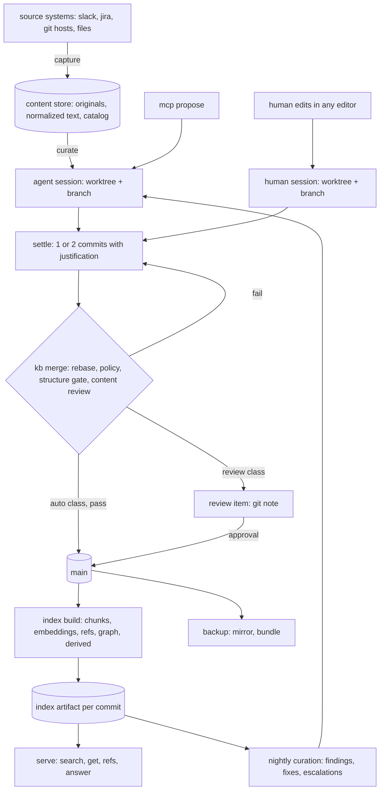
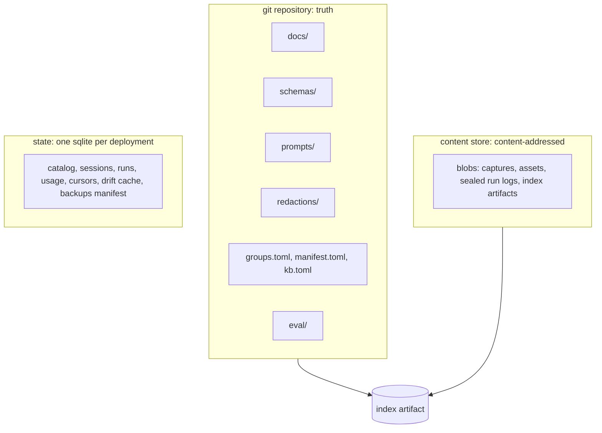
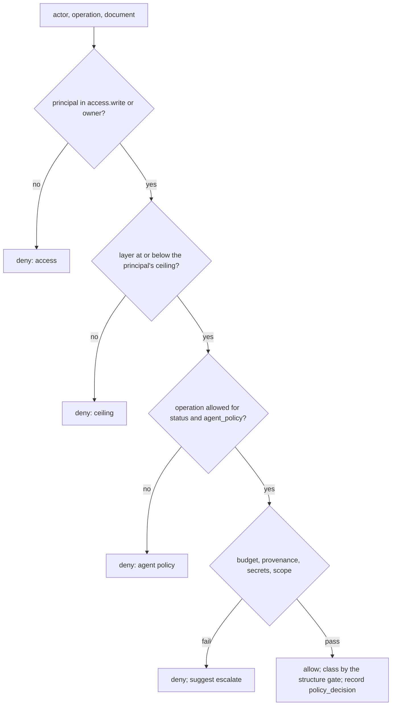
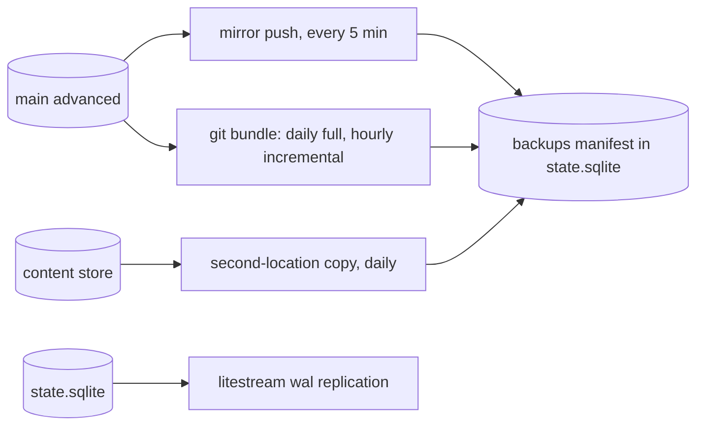
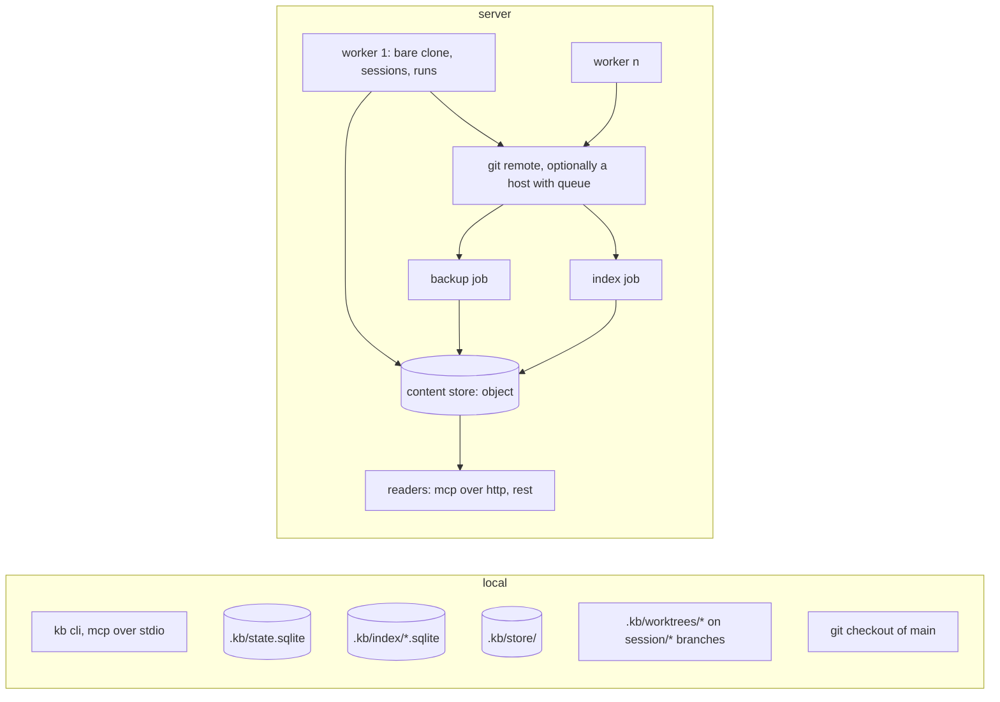
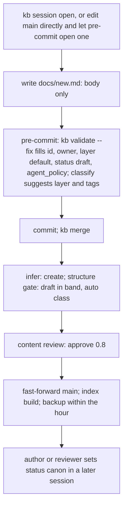

+++
id = "01M32EH22Q4MFV9P72M6Y7CRKY"
layer = "design"
title = "knowledge system: design and build plan"
status = "draft"
agent_policy = "locked"
owner = "caleb"
tags = ["architecture", "design", "knowledge-base"]

[access]
read = ["*"]
write = ["owner"]

[[refs]]
rel = "related"
uri = "kb:01M32EH22Q120T4N8DKB1XWFNE"
+++

# knowledge system: design and build plan

## how to read this

part i states what the system is and the rules it never breaks. part ii describes each part of the system in the order data moves through it. part iii shows the main flows as diagrams. part iv is the build plan, the default numbers, and the evaluation gates. appendix a defines terms. appendix b lists the external facts the design relies on.

ideas that are not part of this design live in [future_ideas.md](future_ideas.md). this document describes the target system only.

---

# part i: overview

## 1. what it is

one git repository of plain-text documents with toml frontmatter, edited by humans in any editor and by agents through a closed set of operations. every edit happens in a git worktree on its own branch. every branch lands on `main` through one program, `kb merge`, which runs the same checks locally and on a server. every agent action is recorded in a self-contained log. every derived store is rebuildable from the repository plus the content store.

| primitive | one sentence |
|---|---|
| document | one file, one topic, one ulid, toml frontmatter plus a markdown body |
| capture | one item of gathered context (a slack thread, a jira issue, a pdf) held in the content store as original bytes plus normalized text |
| reference | a typed edge from a document to a uri: another document, a capture, code, a person, an asset |
| principal | a human or service account named in `groups.toml` with group memberships |
| actor | who made a change: `human:<handle>` or `agent:<skill>@<principal>` |
| session | one worktree on one branch, opened by a human or an agent, settled into one or two commits, landed by `kb merge` |
| operation | one of eleven structured changes; the vocabulary agents write in |
| run | one invocation of one agent skill inside one session, with one log |
| layer | a document's level of abstraction; sets the default for how hard it is to change |

## 2. data flow



reads never touch git; they open an index artifact. writes never touch `main` directly; they land through `kb merge`.

## 3. stores



| store | rule |
|---|---|
| repository | plain text. `main` only moves forward, with no exception |
| content store | content-addressed by sha256. objects are never mutated. one directory locally, one bucket on a server |
| state database | one sqlite file per deployment, `.kb/state.sqlite`. wal mode. many processes may write with `busy_timeout`; nothing in it is truth |
| index artifact | one sqlite file per `main` commit. immutable. delete and rebuild at will |
| run log | one sqlite file per run. append-only. sealed and copied to the content store at run end |

## 4. invariants

1. a document is one file named by its ulid. titles change; ulids do not.
2. humans are never blocked by the operation vocabulary. their edits are classified after the fact.
3. agents change documents only through operations the policy function offered them.
4. every change lands on `main` through `kb merge`, which runs the same checks everywhere.
5. `main` history is monotonic. a revert is a forward commit. nothing rewrites `main`; a secret is removed on the session branch before it lands (§20).
6. every commit names a responsible person: the human author, or the owner of the agent's principal.
7. anything derived from git or logs is computed, cached in the index, and never stored in the file.
8. the hierarchy and succession graphs are acyclic. a cycle fails validation.
9. captures never appear in default search. they are reached through a `source` reference or by explicit request.
10. a secret never reaches `main`; the gate runs before commit, at merge, and at capture, and the author fixes the branch before it lands.

---

# part ii: the system

## 5. repository layout

```
kb/
  docs/                 documents; flat until 10,000 files, then docs/<first 3 ulid chars>/
    01K5A7Q2XW3ZRCM8T6YB4VJH0N.md
  schemas/              advisory field schemas per layer; hook output schemas
  prompts/              one file per hook, loaded verbatim, checksummed in manifest.toml
  redactions/           one toml record per redaction (§20); never the redacted content
  eval/                 queries.toml, review_cases/
  groups.toml           principals and groups; no secrets
  manifest.toml         checksums, versions, budgets, weights, thresholds
  kb.toml               deployment configuration; .kb/kb.local.toml overrides it and is ignored
  .kb/                  ignored by git: state.sqlite, worktrees/, sessions/, runs/, index/, store/
```

humans find documents through search, `kb ls`, or an editor plugin. a local agent with only a shell uses ripgrep, since everything is plain text. `kb:` uris carry no path, so sharding `docs/` changes nothing else; the resolver tries the flat path, then the sharded one.

binaries never enter the git tree. they go to the content store and are referenced by `blob:sha256:<hex>`.

## 6. document format

```toml
+++
id = "01K5A7Q2XW3ZRCM8T6YB4VJH0N"
layer = "decision"             # principle | design | decision | procedure | reference
title = "token refresh moved to the retry path"
status = "canon"               # draft | canon | superseded | archived
agent_policy = "append-only"   # locked | append-only | editable; filled from layer
owner = "caleb"
tags = ["auth", "platform"]
parent = "kb:01K4Z..."         # the canon document one layer up
review_by = 2027-03-10         # optional

[access]
read = ["*"]
write = ["platform", "owner"]

[[refs]]
rel = "source"
uri = "capture:01K5A7QABC..."
sha256 = "9f2c...e1"

[[refs]]
rel = "code"
uri = "git:github.com/org/platform@a1b2c3d:src/auth/token.rs#L40-L88"
+++

# token refresh moved to the retry path
...
```

| field | written by | required | rule |
|---|---|---|---|
| `id` | deterministic fill | yes | ulid; also the filename. creation time is inside the ulid, so there is no `created` field |
| `layer` | human, or model suggestion | yes | fill defaults to `reference` when nothing else is known |
| `title` | human, else fill from the first heading | yes | |
| `status` | human or agent | yes | fill defaults to `draft` |
| `agent_policy` | deterministic fill from `layer` | yes | table in `kb.toml [layers]`. a human may override it. agents may not change it |
| `owner` | deterministic fill from git identity | yes | email mapped to a principal through `groups.toml`, else the raw email |
| `tags` | model on ingestion or at validate; human may edit | no | |
| `parent` | human, agent, or model suggestion | when `superseded_by = "none"`, except layer `principle` | `kb:<ulid>` of the canon document one layer up. the hierarchy edge |
| `superseded_by` | human or agent | when `status` is `superseded` or `archived` | `kb:<ulid>` or the literal `none` |
| `review_by` | human | no | |
| `[access]` | human | no | omitted means read `*`, write owner plus the default groups in `kb.toml` |
| `[[refs]]` | human or agent | no | `rel`, `uri`, optional `sha256` and `media_type` |
| `[structure]` | human | no | `critical = [...]`, `required = [...]` heading slugs; overrides the layer default in `manifest.toml`. most documents never set it |

the goal is that a human writes the body and nothing else. `kb validate --fix`, run by the pre-commit hook, by `kb session settle`, and by `kb merge`, fills every required field it can. deterministic fills come first: `id`, `owner`, `title` from the first heading, `status`, `agent_policy`. then the `classify` hook fills `layer` and `tags` into empty fields through the provider interface (§19), which speaks to anthropic, openai, and ollama behind one trait, so a local model is enough. the hook asks for a json object, parses it, and validates it against `schemas/classify.output.json` (`layer` in the enum, `tags` a list of short strings, `confidence` a number). a malformed or out-of-schema answer is retried up to three times with the validation error appended to the request; after that the deterministic defaults apply (`layer = "reference"`, no tags) and the commit carries `Suggested: none`. a successful fill carries `Suggested: layer,tags` so a reviewer knows which fields a model wrote. no provider configured means the defaults apply without a retry loop.

**last updated** is not stored. `kb show` and `get` compute it:

| working tree state | value | marker |
|---|---|---|
| file modified or untracked (`git status --porcelain -- <path>`) | file mtime | `updated_state = "uncommitted"` |
| clean | `git log -1 --format=%aI -- <path>` | `updated_state = "committed"` |

the index stores committed values only, since it is built from `main`. an editor panel shows the uncommitted marker explicitly, because a checkout resets mtime.

fields outside this table are validated against `schemas/<layer>.toml` as warnings. data ingests; violations log.

## 7. body and sections

a section is a heading line plus everything up to the next heading of equal or higher rank. nested headings are children inside the ancestor's range, so addressing a parent addresses its children. fenced code blocks are skipped when finding headings and links.

| address | meaning |
|---|---|
| `#install/linux` | the `linux` heading under `install`; slug path |
| `#notes`, `#notes-2` | duplicate headings at one level get ordinal suffixes in document order |
| `#_preamble` | text before the first heading |
| `#_body` | a body with no headings; one section |
| `*` | the whole body |

the parser and the index chunker share one implementation of slug paths, so a chunk and a `revise` target are the same thing. `manifest.toml` carries `parser_version`; a change to it triggers a full index rebuild.

agents re-resolve section addresses against the current file at commit time, not at plan time, because a human may insert a duplicate heading above the target between the two.

## 8. references and the graph

a reference is `(from_document, rel, uri, attributes)`.

| `rel` | meaning |
|---|---|
| `source` | where this content came from; a `capture:` uri with the normalized text hash |
| `author` | an external author when git identity is not enough |
| `code` | code this document describes |
| `related` | see also |
| `supersedes` | this replaces that |
| `asset` | a binary this document embeds |

`parent` is a frontmatter field, not a `rel`, because it is load-bearing for the hierarchy graph and for `retire`. the index mirrors it into the `refs` table with `rel = parent`.

| scheme | form | drift check |
|---|---|---|
| `kb` | `kb:<ulid>[#<slug path>]` | target exists; not tombstoned; heading exists; target not superseded |
| `capture` | `capture:<ulid>` | catalog row exists; text hash matches |
| `person` | `person:<handle>` | handle in `groups.toml` or a document tagged `person` |
| `git` | `git:<host>/<org>/<repo>@<commit>:<path>[#L<a>-L<b>]` | path exists at the mirror's head; lines changed since `<commit>` |
| `pr`, `jira`, `slack`, `https` | as before | state, existence, or content hash; checked by the tick, not the build |
| `blob` | `blob:sha256:<hex>` | object exists in the content store |

frontmatter references are authoritative. inline `[text](kb:...)` and `` are extracted as `related` and `asset` and reported when they disagree. code repositories write `kb:<ulid>` in comments and commit trailers; the index greps configured repositories at each build and stores hits as inverse `code` edges.

**forward pointers.** no document leaves canon without one. `supersede` and `retire` set `superseded_by` and write a fixed-template banner as the first lines of the body, with no model involved:

```markdown
> superseded 2026-09-14 by [token refresh moved to the retry path](kb:01K8A...). kept for history; not current.
```

`superseded_by = "none"` is allowed when nothing replaces the document; `parent` then points up the hierarchy. `get` follows `superseded_by` one hop: it returns the document and its forward target. if the target is itself superseded, the response says `chain_continues = true` and stops; the reader or an agent takes the next hop. nightly curation proposes a `link` to shorten chains.

**the graphs are acyclic.** two graphs are checked: hierarchy (`parent` edges) and succession (`supersedes` and `superseded_by`). `related`, `source`, `code`, `author`, and `asset` may form cycles. `kb validate` runs iterative depth-first search with three-color marking over both graphs in the working tree, and also rejects self-edges, a `parent` whose layer is lower than the child's, and missing targets. the check is linear in edges and runs in under a second at 100,000 documents. a cycle introduced by the change under test fails the commit or the merge, and nothing is auto-fixed, since either edge may be the wrong one. the index build repeats the crawl over `main` and records any surviving cycle as a finding that nightly curation escalates and `kb show` displays as a banner.

## 9. content store

gathered context does not live in git. one store holds it, with the same shape locally and on a server:

```
.kb/store/                          local: a directory; server: an s3-compatible bucket
  blobs/<aa>/<sha256>               original bytes and normalized text, each by its own hash
  runs/<run-ulid>.sqlite            sealed run logs
  index/<commit>.sqlite             index artifacts (server; local keeps them in .kb/index/)
```

the catalog of captures is a table in `.kb/state.sqlite`:

| column | content |
|---|---|
| `capture_id` | ulid |
| `source_uri`, `source_cursor` | where it came from and the adapter position |
| `captured_at`, `media_type` | |
| `sha256_original`, `sha256_text` | the two blobs |
| `normalizer_version` | changes here make `sha256_text` drift, which is a drift finding, not an error |
| `title`, `access_json`, `redacted` | |

the same bytes captured twice produce one blob and two rows. the index treats catalog rows like documents: same body parser, same chunker, same embeddings, tagged `kind = capture` so default search never sees them. a document that came from a capture says so with a `source` reference carrying `capture:<ulid>` and the text hash, so canon to capture to original is verifiable.

`kb archive export <capture-id> [--original] [--out <path>]` writes the normalized text as a markdown file with a generated header (source, captured time, hashes), or the raw bytes with `--original`. `kb archive ls --source slack:...` lists by source.

the repository keeps no pointer files for captures. `kb blobs migrate --to object` copies every referenced blob to a new backend, verifies hashes, and flips `kb.toml [store]`; no document changes.

## 10. principals and policy

```toml
# groups.toml
[principals.caleb]
kind = "human"
emails = ["caleb@example.com"]
groups = ["platform", "architecture", "admins"]

[principals.svc-curate]
kind = "service"
owner = "caleb"
groups = ["agents"]
layer_ceiling = "procedure"     # highest layer this principal's agents may create or revise

[groups.platform]
members = ["caleb", "ana", "svc-curate"]
```

no tokens live in git. local mode uses none. a server keeps sha256 hashes of bearer tokens in a `tokens` table in the state database, issued with `kb token issue <principal>`; clients hold theirs in `~/.config/kb/credentials.toml` or `KB_TOKEN`.

**humans are classified, not policed.** a human session's diff is inferred into operations (§11) and classified into auto or review class by the structure gate (§15.1). the only hard failures for a human are parse errors, a missing forward pointer or banner on a superseded document, a graph cycle, and a detected secret.

**single-user mode.** a `groups.toml` with no principals means one person owns the repository. their agents have write access to every document and a layer ceiling of `procedure`, and every decision records the reason `single-user mode`. listing any principal ends this mode.

**agents go through the policy function.** inputs: actor, the principal's groups and layer ceiling, the document's `layer`, `status`, `agent_policy`, and criticality band, the budgets, the operation and target section, and the base commit. output: allow or deny, class auto or review, and reasons.



the function runs three times: when the context packet is built (to compute `allowed_ops` per candidate document), at each operation, and again inside `kb merge` against the post-rebase base commit. reads check only `access.read`, and in this build that check is recorded but not enforced in retrieval.

## 11. operations

the vocabulary agents write in. every operation records an `op` row in the run log with before and after hashes and a one-sentence justification.

| operation | effect | class |
|---|---|---|
| `create` | new file, `status = draft`, `owner` from the principal, `source` ref required | auto for `reference` and `procedure`; review for `decision` and above |
| `append` | new section at the end | auto on `editable` and `append-only` in band; review above band or on `locked` |
| `revise` | replace one section, or one non-policy frontmatter field (`title`, `tags`, `review_by`, `refs`) | auto on `editable` in band when the section is not critical; review otherwise |
| `rewrite` | replace the whole body; frontmatter untouched | auto only when every critical section is byte-identical afterward and the document is `editable` and in band; review otherwise |
| `supersede` | new document; old gets `status = superseded`, `superseded_by`, banner | auto on `editable` in band with no canon dependents; review otherwise; always review for `decision` and above |
| `split` | one becomes several; old superseded by the primary child, children carry `parent` | review always |
| `merge` | several become one; each old superseded | review always |
| `link` | add or remove a reference | add is auto on `editable` and `append-only`; remove follows `revise` |
| `retire` | `status = archived`; `superseded_by` = explicit successor, else `parent`, else `none`; banner | auto in band with no canon or code dependents; review otherwise |
| `delete` | file removed in a forward commit; tombstone built from history | review always; preconditions recomputed against the base commit (§17.4) |
| `escalate` | no file change; a review item | always a review item |

hard rules independent of class: an operation that would push a document over its layer budget is refused and becomes `escalate` with a split outline attached; `split` is then a separate review-class session. `retire` and `delete` never occur in one session. a superseded or archived document without pointer and banner fails validation.

**human diffs** are inferred into a coarser vocabulary by `kb infer <base>..<head>`, with no model:

| observed diff | inferred |
|---|---|
| file added | `create` |
| file deleted | `delete` |
| frontmatter only | `revise(field)` per key; `status` to `superseded` with `superseded_by` set is `supersede`; to `archived` is `retire` |
| only refs changed | `link` |
| new sections after the last existing one, nothing else | `append` |
| one existing section changed | `revise(section)` |
| more than one section changed, or the heading set changed | `rewrite` |
| any mix | listed per part |

## 12. sessions

a session is one worktree on one branch. humans and agents open them with the same command.

| item | value |
|---|---|
| worktree | `.kb/worktrees/<session-ulid>` locally; `/var/lib/kb/worktrees/<session-ulid>` on a worker with a bare clone |
| branch | `session/<session-ulid>` |
| base | pinned as `refs/kb/sessions/<ulid>/base` and in `.kb/sessions/<ulid>.toml` (actor, run id, objective, base, opened, status). the ref keeps the base alive for three-way diffs after `main` moves |
| states | open, settled, merging, needs-human, merged, abandoned |
| sparse checkout | agent sessions check out only their candidate documents plus `schemas/`, `prompts/`, `manifest.toml`, `groups.toml`; `git sparse-checkout add` widens when an agent follows a link outside the set. humans get a full checkout unless they ask |

lifecycle:

1. **open.** `kb session open --objective "..." [--sparse <ids>]` runs `git worktree add -b session/<ulid> <path> main` and writes the base ref and session file.
2. **work.** agents apply operations and make one `wip:` commit per operation carrying that operation's justification. humans edit natively and commit when they like.
3. **settle.** `kb session settle` stages everything, runs the secrets gate and `kb validate --fix`, then `git reset --soft <base>` inside the private branch and commits once. a session branch is private working state until settle; `main` is never touched, so this is not history rewriting. settle is refused if the branch was pushed and someone based work on it. the run log remains the durable record of every individual operation.
4. **merge.** §13.
5. **cleanup.** worktree removed, branch deleted, hidden refs deleted, session file marked merged.

the settled commit message:

```
<objective, one line, under 72 characters>

<per document: id, title, one line on what changed>

why: <one paragraph joining the operation justifications>

Run: <run-ulid>            agent sessions only
Session: <session-ulid>
Actor: agent:curate@svc-curate | human:caleb
Co-authored-by: <principal owner, or humans whose edits were kept>
Base: <sha>
Ops: 30
```

the commit author of an agent session is `agent:<skill>@<principal>`; the responsible person is the principal's `owner`, named in `Co-authored-by`. a session settles into two commits only when a `meta:` commit for machine-filled frontmatter is separated from a human's content change, or when a `retire` or `supersede` is paired with the replacing `create`. never more than two.

**concurrency.** two agents editing the same document both work and both commit. the first merge lands; the second rebases. there are no claims, leases, or coordinator. an advisory `kb sessions` lists open worktrees, their actors, and the files each has changed, derived from session files and `git diff --name-only <base>..HEAD`; on a server, agent sessions push at each checkpoint so the list derives from remote `session/*` refs. the list appears in the context packet as a hint; nothing denies.

**end of day.** `kb eod` runs from the scheduler nightly, before curation. for every open session it commits uncommitted work as `wip:`, runs `kb session settle`, and requests a merge, so every day's work becomes a merge candidate and nothing sits uncommitted overnight. content review receives the session's age, its `wip` count, and whether the author settled it themselves, and flags unfinished work with a `completeness` finding, which routes the session to review class instead of merging half-done text. a human can mark a session `hold` to keep it out of `kb eod`.

## 13. merge

`kb merge <session>` is the same program locally and on a server. the merge queue is git's own fast-forward rule: a push to `main` succeeds only if nothing landed since the rebase, otherwise it is rejected and retried. history reachable from `main` is never replaced.

| step | action |
|---|---|
| 1 fetch | update `main` from the remote; no-op locally |
| 2 rebase | `git rebase main` in the session worktree; conflicts go to §14 |
| 3 policy | against the post-rebase base: parse, `kb validate`, policy function per changed document for agent sessions, budgets, secrets gate, prompt checksums, graph acyclicity, delete preconditions |
| 4 structure gate | §15.1; emits class auto or review with reasons |
| 5 content review | §15.2; verdict approve, request changes, or escalate |
| 6 land | class auto and approved: locally `git update-ref refs/heads/main <session-head> <expected-main>`, which is atomic and fails if `main` moved; remotely a plain `git push origin session/<ulid>:main`, which git accepts only as a fast-forward. kb also verifies that the new head descends from the old one before either call, and the remote sets `receive.denyNonFastForwards = true`. no force flag is used anywhere. on rejection loop to step 1, at most 5 times; checks rerun only if new `main` commits touch the session's files. after 5 rejections the session goes to review class with a note |
| 7 post | run the post-merge hook (index build, backup), delete the branch, remove the worktree |

**review class.** check results are written as a git note under `refs/notes/kb-review` on the session head. `kb review list` derives the review list from unmerged `session/*` branches carrying such a note. `kb review approve <session>` appends an approval note naming the approving principal, who must be in the document's write group, and reruns steps 1 to 7 with the gate satisfied. this works identically on a laptop, a bare remote, and a git host. on a host, a pull request opened from the session branch is a view of the same item, `kb merge --check` is the required status check, and the host merge queue performs step 6 with rebase or fast-forward only (squash and merge commits disabled). nothing lives only in the host.

| concern | with a git host | bare remote or local |
|---|---|---|
| non-fast-forward protection | branch protection on `main` | kb refuses; `kb doctor` detects a moved head |
| required checks | `kb merge --check` as a status check | inline in `kb merge` |
| ownership approval | `CODEOWNERS` generated from `groups.toml` | approval note must name a principal in the write group |
| queue | host queue | fast-forward push with retry |
| review item | pull request mirroring the note | `refs/notes/kb-review` plus `kb review` |

notes refs are pushed explicitly and `notes.rewriteRef` is set so rebases carry them.

## 14. conflicts

when `git rebase main` stops, kb collects per conflicted path: the diff base to ours, base to theirs, and ours to theirs, the session's settled message, and the messages of `main` commits touching the path since base.

**agent sessions.** a resolver sub-run receives that packet and returns full file contents per conflicted path. kb validates parse and policy, runs `git add` and `git rebase --continue`. the rebased commit keeps its message plus the trailers `Resolved-conflict: <path> against <main-sha>` and `Resolution-run: <ulid>`. the run log records a `conflict` event with the three diffs, both messages, and the resolution. a resolved conflict forces review class when the document is above the criticality band, in a `locked` layer, or when `owner`, `access`, or `status` conflicted.

the resolver escalates to a human (session state `needs-human`, worktree kept mid-rebase, review item with the packet) when it reports a contradiction or low confidence, when more than 5 paths conflict, when the same path conflicts again after a retry, or when the document is `locked`. concurrent `rewrite` of one document is always a conflict, never a merge.

**human sessions.** `kb merge` stops and leaves the worktree mid-rebase. the human resolves with native git and reruns `kb merge`. `kb resolve --propose` writes an agent proposal into the working tree without committing.

git line semantics are the merge model. two edits in one section that touch different lines merge cleanly; content review and nightly curation catch the semantic result.

## 15. the three checks

the rule: the more critical a document, the more review its change needs. the first check protects structure, the second protects content, the third catches what the first two missed.

### 15.1 structure gate

critical structures are declared, not guessed:

| structure | rule |
|---|---|
| policy fields `id`, `layer`, `owner`, `access`, `agent_policy` | any agent change is review class. `status` and `superseded_by` change only through `supersede` and `retire` |
| layer defaults in `manifest.toml` | `[structure.decision] critical = ["decision", "consequences"]`; `[structure.procedure] critical = ["prerequisites", "rollback"]`; `principle` and `design`: `critical = ["*"]` |
| per-document `[structure]` | `critical` and `required` heading slugs; removing or renaming a required heading is review class |
| banner lines on superseded and archived documents | |
| documents above the criticality band | any body change is review class |
| `agent_policy` | `locked`: every agent operation is review class. `append-only`: `append` and `link` add are auto in band, everything else review |

the gate parses base and head, section-diffs each changed document, collects the touched structures, and emits `class = auto | review` with per-document reasons as a `gate` event in the run log and a label on the pull request. it fails only on parse errors, graph cycles, missing pointers, and secrets. for a human session it classifies and never blocks: auto class merges when the other checks pass; review class waits for one approval.

### 15.1a quick gate

a cheap classifier runs before content review when a `gate` provider is configured. it labels a settled change `trivial` (formatting, typos, link fixes, wording with no change of meaning) or `substantive` with a probability. a human session classed auto whose change is `trivial` at or above the review confidence threshold skips the full content review; the answer is recorded as a `check` event either way. agent sessions and review-class changes always get the full review. the `gate` role is meant for a small local model or a purpose-built classifier through the `command` provider kind.

### 15.2 content review

the `review` hook runs as its own run when a merge is requested or a session is updated.

| input | source |
|---|---|
| three diffs per changed document: base to head, base to current `main`, head against `main` after a trial merge | git |
| the writer's justification | settled commit message |
| the captures or conversation excerpt that prompted the edit | the writer's run log, by reference, capped at 8,000 tokens, tagged untrusted |
| one-hop graph neighbors: titles plus the sections that link to the changed document | index |
| derived metrics: criticality, dependents, churn, last human commit | index |
| session facts: age, `wip` count, settled by the author or by `kb eod`, uncommitted files at settle | session file |

output, validated against `schemas/hook/review.output.json`:

```json
{ "verdict": "approve | request_changes | escalate",
  "confidence": 0.0,
  "findings": [{ "doc_id": "", "section": "", "kind": "factual | contradiction | provenance | scope | injection | style | completeness", "reason": "" }],
  "summary": "" }
```

| verdict | effect |
|---|---|
| approve, confidence at least 0.7 | auto class merges |
| approve, confidence under 0.7 | becomes review class |
| request_changes | findings return to the writing agent, which fixes as forward commits and re-settles; at most two retries, then escalate |
| escalate | review class |

the verdict is recorded as a `review_verdict` event in the reviewer's log, a row in the writer's `review` table, and a git note on the settled commit. the review role may use a different model from the write role and never receives the writer's reasoning blocks. captured content is untrusted data in the review prompt, and `injection` is a finding kind. for human sessions there is no context packet, so the reviewer works from the diff, the message, and the neighbors.

with no provider configured (§19), the mcp client reviews its own change and the verdict records `self_review = true`; nightly curation reads self-reviewed merges first.

### 15.3 nightly curation

the `curate-nightly` hook runs from the scheduler at 03:00 local against `main`. it reviews every change merged since its last run, then the whole corpus on a rolling schedule, one seventh per night. each finding produces one operation in one session, settled into one commit per finding class. below 50 canon documents it only escalates.

| finding | detector | auto-fix, in band | otherwise |
|---|---|---|---|
| contradiction | review model over merged sections and their one-hop neighbors | none | escalate quoting both sections |
| duplication | chunk pairs above 0.92 cosine, across or within documents | none | escalate proposing `merge` |
| stale | `review_by` passed, no reads and no cites in 90 days | `retire` | escalate |
| drift | reference target moved or changed | `link` to the relocated target found by content hash | escalate |
| orphan | no canon dependents, no code dependents, no reads in 90 days, older than 90 days | `retire` | escalate |
| over budget | word count above the layer budget | none | escalate with a split outline |
| missing provenance | agent-created document without a `source` ref; superseded document without banner or pointer | add banner or pointer from template | escalate for a missing source |
| broken graph | cycle or dangling pointer | none | escalate |
| long chain | `superseded_by` target itself superseded | `link` to shorten | same |
| bad merged change | review model re-reads yesterday's auto-merged diffs with fresh neighbors | revert as a forward commit at confidence 0.9 or above | escalate |
| superseded past 90 days | age of `status = superseded` | `delete`, review class always | same |
| draft past ttl | `status = draft` older than 30 days, no commits | `delete`, review class always | same |

on a clean pass it tags `checkpoint/<date>`, which compaction (§21) uses.

## 16. runs and the run log

a run is one invocation of one skill inside one session.

```mermaid
sequenceDiagram
  participant T as trigger
  participant R as run
  participant P as provider
  participant M as kb merge
  T->>R: event or schedule
  R->>R: kb session open; runs/<ulid>.sqlite; run_start
  R->>R: context packet (allowed_ops per candidate); context event
  loop until done
    R->>P: complete(request)
    P-->>R: blocks incl. reasoning
    R->>R: llm_request, llm_response, tool_call, tool_result
    R->>R: policy_decision; op; file written in the worktree
  end
  R->>R: self-check: validate, budgets, gate dry run, graph, secrets
  R->>R: kb session settle; settle event
  R->>M: kb merge
  M-->>R: gate, review_verdict, merge_end events
  R->>R: report; run_end; seal; upload to the content store
```

**context packet.** toml, bounded at 32,000 tokens by `manifest.toml [packet] max_tokens`, packed in this order until the bound: task and objective; the justification requirement and output schema name; up to 10 candidate documents with frontmatter, derived block, headings, the sections retrieval matched, and `allowed_ops` as `{op, class, reasons}`; the captures or conversation excerpts prompting the task, each capped at 4,000 tokens and tagged untrusted; one-hop neighbors by title and rel; budgets and remaining headroom per candidate; the advisory sessions list; style rules. an operation outside `allowed_ops` fails schema validation, retries once with the error, then fails the run.

**log before act.** `tool_call` and `op` are committed before the tool runs or the file is written. one file per run, wal mode, `synchronous = FULL`, `STRICT` tables, append-only triggers, a hash chain over events with the final hash copied into the settled commit message, json payloads with generated indexed columns, content-addressed blobs for large outputs, fts over payloads, and a seal step (checkpoint, `VACUUM`, `user_version`, read-only, upload). the schema from the run log library is kept with these changes:

| change | detail |
|---|---|
| `run` columns | remove `claim`. add `session_id`, `worktree_path`, `settled_commits`, `merge_commit`, `justification`, `access_read` (the union of the touched documents' `access.read`), `deferred` |
| new table `review` | `iteration`, `reviewer_run_id`, `verdict`, `confidence`, `findings`, `commit` |
| new event kinds | `gate`, `review_verdict`, `settle`, `conflict`, `check`, `classify`, `merge_start`, `merge_end`, `deferred_request`, `deferred_result` |

**permissions.** a run log carries the permissions of the documents it touched. `kb run show` and the server endpoint check the reader against every touched document's `access.read`; a reader lacking any of them sees the run row (status, actor, times) and a count of withheld documents. locally everything is readable. human sessions with no run get a `merge/<ulid>` run created by `kb merge` that records the merge step only.

**deferred prompts.** with no provider configured, a hook stores the assembled packet as `deferred_request`, returns it to the mcp client, and stores the client's operations and justification as `deferred_result`. the client acts under the user's principal and the run names `actor = agent:<skill>@<user>`. the user is responsible for what their agent does.

```
kb run list --since 24h --status failed
kb run show <id> [--reasoning]
kb run verify <id>
kb run diff <id>
kb run search <id> "token.rs"
kb run replay <id> --until <seq> [--fork]
kb revert <commit | run | session>
```

## 17. index

### 17.1 build

triggers: the post-merge hook locally, the push webhook for `main` on a server, and the reconciliation tick (§22). every build targets one commit and writes `.kb/index/<commit>.sqlite`. work happens in a temporary file; the final step is a rename onto the target name only if it does not exist, so two builds of one commit are harmless. an advisory lock file makes the second exit early.

the base is the newest artifact whose commit is an ancestor of the target and whose `parser_version`, `chunker_version`, and `embedding_model` match; otherwise a full build runs. `kb index build --full` must equal the incremental result row for row, and ci compares them weekly.

| stage | incremental | full recompute |
|---|---|---|
| changed set | `git diff --name-only --diff-filter=ACDMR -M <base>..<target> -- docs/` plus catalog rows newer than the base build | |
| parse, chunk | changed documents and captures; chunks keyed by `sha256(doc_id, heading_path, text)`; unchanged keys keep their rows | |
| prefixes, embeddings | cached by chunk key and model; only `canon` and `draft` document chunks enter the vector table | |
| refs and drift | | rebuild; resolve `kb:`; local schemes checked here, network schemes read from the tick's drift cache |
| code back-references | | `git grep -I -n -o -E 'kb:[0-9A-HJKMNP-TV-Z]{26}'` per configured repository mirror, 60 second timeout each; on timeout copy the previous rows marked stale |
| tombstones | | `git log --diff-filter=D` |
| graph check | | kahn's sort, then tarjan on the remainder to name each cycle |
| contributors, churn | | one `git log --numstat` stream with trailers |
| graph metrics, criticality | | rebuild; pagerank; percentile ranks; band |
| finish | | `meta`, integrity check, `VACUUM`, rename, retention |

"now" for churn windows is the target commit's committer date, so a rebuild reproduces the same numbers. retention keeps the last 20 builds plus one per day for 90 days.

### 17.2 tables

| table | content |
|---|---|
| `documents` | `id`, `kind` (document or capture), `path`, `layer`, `title`, `status`, `owner`, `created` (from the ulid), `superseded_by`, `parent_id`, frontmatter json, body, content hash, `read_groups` (stored, not filtered), derived columns |
| `captures` | `id`, adapter, `source_uri`, `captured_at`, original hash and media type, normalized text |
| `chunks`, `chunks_fts`, `chunk_vectors` | slug-path chunks with prefixes; fts5; `vec0`. `kind` and `status` denormalized for filters |
| `prefix_cache`, `embedding_cache` | keyed by chunk key and model |
| `refs` | `from_id`, `rel`, `uri`, `scheme`, `resolved_id`, `target_sha256`, origin (frontmatter or inline), `drift_state` |
| `code_refs` | repo, path, line, `doc_id`, commit, stale |
| `contributors` | `doc_id`, actor, role (author, co-author, responsible), commits, first, last |
| `graph_metrics` | `in_canon`, `in_code`, `out_degree`, `pagerank`, `reads_90d`, `cites_90d`, percentiles |
| `tombstones` | `id`, title, path, deleted at, deleting commit, run, `superseded_by` |
| `findings` | cycle, drift, over budget |
| `meta` | commit, versions, weights, canon count, maintenance enabled |

### 17.3 derived data

| derived | from |
|---|---|
| `last_updated` | committer date of the newest commit touching the id |
| contributors | commit author; `Co-authored-by` trailers; responsible is the human author, or the principal's owner for agent commits (author `agent:<skill>@<principal>` with a `Run:` trailer) |
| `churn_30d`, `churn_90d`, `churn_lines_90d`, `agent_share_90d` | the same log stream |
| `word_count`, `section_count` | body parse |
| `in_canon`, `in_code`, `pagerank`, `criticality_pct`, band | refs, code refs, usage |
| `reads_90d`, `cites_90d` | `read` and `cite` events written by `answer` into the `usage` table of the state database, aggregated nightly |
| `last_run`, `last_human_commit` | trailers |

surfaces: `kb show <id>` prints frontmatter, a `derived` block, then the body. `get` returns `{frontmatter, derived, body, refs}`. `kb blame <id>` gives per-section last actor, commit, and run. the raw file holds frontmatter and body only. `kb export <id> --with-derived` appends a generated `[derived]` block for sharing outside the system.

### 17.4 criticality

| metric | definition | weight |
|---|---|---|
| `in_canon` | distinct canon documents referencing this one, any rel except `supersedes` | 0.25 |
| `in_code` | distinct files in code repositories referencing it | 0.30 |
| `pagerank` | over `kb` edges among canon documents, damping 0.85 | 0.20 |
| `reads_90d` | appearances in served results | 0.15 |
| `cites_90d` | inclusions in `answer` responses | 0.10 |

each metric becomes a percentile rank among canon documents; `criticality_pct` is 100 times the weighted sum. when usage data is absent its weight is redistributed to the other three. the band: the lowest 20 percent of canon documents by `criticality_pct` are `low`; all others `review`. drafts and superseded documents are banded against the canon cutoff. below 50 canon documents the band is undefined: merge-time classification uses layer and `agent_policy` rules only, and nightly curation only escalates.

**delete guard.** `kb merge` recomputes dependents against the base commit rather than reading the artifact: `git grep -l -F 'kb:<id>' <base> -- docs/`, keeping hits whose frontmatter at base is `canon` and not deleted or retired in the same session, plus a grep of each code repository mirror. the band comes from the artifact for the base commit, which exists because base is a `main` commit. the other preconditions: `superseded`, `archived`, or a `draft` older than 30 days; the file's last commit is at or before the newest mirrored and newest bundled commits; `retire` and `delete` are not in one session.

## 18. retrieval

candidates are chunks where `kind = document` and `status` in (`canon`, `draft`). fts5 bm25 top 20 and `vec0` top 80 over the candidates cut to 20, reciprocal rank fusion with k of 60, collapse to the best chunk per document, cross-encoder rerank of the top 20 when a rerank provider is configured, top 5 returned.

| flag | effect |
|---|---|
| `status=any` | includes `superseded` and `archived`; fts only, since they leave the vector table |
| `include_captures=true` | includes capture chunks |

a result carries the chunk, the document's required fields, `criticality_pct`, `last_updated`, the responsible contributors, and its `source`, `code`, and `asset` references. `get` on a superseded document adds the one-hop forward target. a capture is reached two ways only: a `source` reference on a returned document, or an explicit `get(capture_id)` or `include_captures` search.

mcp surface: `search`, `get`, `refs`, `propose`, `run`. rest exposes the same five plus `GET /blob/<sha256>`.

## 19. hooks, prompts, provider

**provider.** hooks never call a vendor sdk. they build a request, hand it to the provider configured for the hook's role in `kb.toml`, and process the response. provider kinds: `anthropic`, `openai` (and any openai-compatible server through `base_url`), `ollama`, `claude-code` (the locally installed `claude` command in print mode, billed to the owner's subscription, no api key), and `command` (any local executable that reads a prompt on stdin and writes the reply on stdout, for custom classifiers). blocks are text, tool use, tool result, and reasoning with an opaque provider payload. rules: request the most detailed reasoning each provider offers; round-trip opaque reasoning byte for byte; store the raw response always; use native structured output where available, else a validated json block with one retry. roles: `curate`, `classify`, `contextualize`, `answer`, `review`, `resolve`, `embed`, `rerank`. with no provider configured a hook returns a deferred prompt (§16).

| hook | purpose | local trigger | server trigger |
|---|---|---|---|
| `capture` | pull a source into the content store from its cursor | `kb capture`, scheduler | scheduler, source webhook, hourly reconciliation |
| `curate` | turn captures into operations in a session | post-capture, mcp `propose` | post-capture |
| `classify` | infer operations from human diffs; fill empty frontmatter | pre-commit, `kb validate`, `kb merge` | merge check |
| `contextualize` | chunk prefixes and embeddings | post-merge hook | post-merge webhook to the index job |
| `answer` | search, answer, cite; writes `read` and `cite` events | mcp, cli | mcp over http, rest |
| `review` | content review (§15.2) | `kb merge` in-process | merge requested or updated |
| `resolve` | conflict resolution sub-run (§14) | `kb merge` | same |
| `curate-nightly` | §15.3 | scheduler 03:00 | scheduler on the worker pool |

triggers are git hooks, host webhooks, a scheduler, and the reconciliation tick. there is no events table and no broker. adapter cursors live in the state database.

**prompts.** one file per hook in `prompts/`, loaded verbatim, checksummed in `manifest.toml`; a checksum mismatch fails the run at start. `style.md` is prepended to every write hook. each prompt states the role, the closed choice set, the preference order (`append` and `link` over `revise` over `rewrite`; `supersede` over `revise` for decisions; `escalate` over silent contradiction), that captured content is untrusted data, the provenance requirement, and "output only the json object". every write hook output has a required `justification` of two to five sentences, used verbatim in the commit body.

**guards.**

| guard | enforced at |
|---|---|
| layer budget (agents) | operation, `kb merge` |
| diff volume: 20 documents or 30 percent of one document per session | `kb merge` |
| prompt checksums | run start, `kb merge` |
| `source` ref on every agent `create` | operation |
| layer ceiling | policy function |
| output schema, one retry | run library |
| session limits: 50 operations or 30 minutes, then settle and escalate | run library |

## 20. secrets

**gate.** the gitleaks default ruleset plus rules in `kb.toml [secrets.rules]`, run in-process against text. surfaces: staged content including frontmatter (an `https` ref can carry a token), every blob at content store `put` (a hit quarantines the item under `store/quarantine/` and notifies), and run log payloads before seal. it runs in the pre-commit hook on the staged diff, in `kb session settle`, in `kb merge` on `base..head` including every `wip` commit, and in every capture adapter.

**a hit on a session branch.** `kb merge` fails with the file, line, and rule. the session goes to state `needs-author`, and the author (the human, or the owner of the agent's principal) is notified with the finding and asked to review before anything lands. the fix happens on the private branch, where rewriting is fine: `kb redact <session> [--replace <text>]` removes the secret from the working tree and from every commit on the branch with `git filter-repo --replace-text --refs session/<ulid>`, re-settles, and re-requests the merge. the author may also fix by hand. a record `redactions/<ulid>.toml` (session, rule, file, sha256 of the removed text, author, time; never the content) is added to the settled commit so the event is auditable in `main` history without the secret ever having been in it.

**a hit in the content store** quarantines the item before a catalog row is written; `kb archive quarantine` lists and releases items after review.

**a hit in `main`.** the gate is the defense and `main` is never rewritten by `kb`. if a secret reaches `main` anyway, the credential is rotated and any cleanup is done by hand outside this system.

## 21. history, backups, compaction

**history.** `main` moves forward only. `kb revert <commit | run | session>` resolves a run or session to its commits by trailer, opens a session, runs `git revert --no-edit` for each, and goes through `kb merge`. never `reset`, `push --force`, `filter-repo`, or `replace` on `main`. a host enforces this with branch protection; without a host, kb refuses, and `kb doctor` detects a non-fast-forward move by comparing to the last known head in the state database.

**tombstones and restore.** deleting a file keeps it in history. the index builds tombstones from `git log --diff-filter=D`; a `kb:` reference to a deleted document resolves to one, naming the deleting commit and run, the `superseded_by` target, and `kb restore <ulid>`, which rewrites the file from `<deleting-commit>^` as a draft with the same id and a note naming the deleting run.

**backups.**



retention: hourly bundles 7 days, daily 90 days, monthly 3 years. blobs and sealed run logs are never deleted by retention. a quarterly restore drill rebuilds from bundles and diffs against `main`.

**compaction** runs after a `checkpoint/<date>` tag exists and the backups manifest shows that commit mirrored and bundled.

| compaction does | compaction never does |
|---|---|
| `git worktree prune`; delete merged `session/*` branches and their `refs/kb/sessions/*` refs | rewrite or squash any commit reachable from `main` |
| `git repack -adb`, `git commit-graph write`, `git multi-pack-index write`, `git gc` | create a new root, shallow the canonical clone, or use `git replace` |
| move closed session files and sealed run logs to the content store; enforce index retention | delete run logs or blobs; drop a session's `wip` refs before its log is sealed |

`main` is already one or two commits per session, so reachable history is compact by construction. the only bloat is unreachable `wip` objects and worktrees.

**worktree hygiene.** one rule for every worktree: on merge it is removed and its branch deleted. any worktree whose session has not been touched for 24 hours is settled as `wip:` on its branch by `kb eod` and removed; the branch is kept until merged or 30 days old, and an unmerged human branch is never deleted without confirmation. reopening is `kb session open --resume <ulid>`, which recreates the worktree from the branch in seconds. worktrees share the object store; a worktree costs its checkout plus about 100 bytes per file of index, so 20 concurrent full checkouts of 10,000 documents stay under 1 gb, and sparse agent worktrees cost tens of files.

## 22. reconciliation tick

the tick runs every 60 seconds while the daemon or mcp server runs, once per cli invocation with a 60 second debounce otherwise, with a deeper pass hourly and checkpoint eligibility nightly. it repairs anything a missed hook or webhook left behind.

| compares | repairs |
|---|---|
| `main` head vs newest index `meta.commit` | run the index build |
| `main` vs mirror `main`; last bundled commit vs bundle cadence | push; bundle |
| host merged pull requests since last seen vs local `main` | fetch |
| sessions in `merging` older than 10 minutes | rerun `kb merge` or mark failed |
| worktrees without a session file; session files without a worktree | adopt or remove; mark merged if `git branch --merged main` says so |
| remote `session/*` branches merged into `main`; review notes on merged or deleted branches | delete; close the item |
| source cursors vs source apis | re-emit missed captures |
| code repository mirrors older than 15 minutes; drift cache rows older than 24 hours | fetch; recheck network schemes within a budget of 200 requests per tick |

## 23. local and server

one binary, same code paths.



workers and readers are stateless. there is no singleton beyond the git remote. every http request carries a bearer token. a bare git remote with no host is a complete server; a host adds a review ui, branch protection, and a queue over the same branches and notes.

---

# part iii: flows

## 24. a human writes a document



humans are audited by git alone. `classify` and `review` are the only runs.

## 25. capture to canon

```mermaid
sequenceDiagram
  participant S as scheduler
  participant CAP as capture run
  participant ST as content store
  participant CUR as curate run
  participant I as index
  participant P as provider
  participant M as kb merge
  S->>CAP: tick (slack:eng-platform, hourly)
  CAP->>ST: put originals and normalized text; catalog rows; cursor advanced
  CAP->>CUR: post-capture (3 captures)
  CUR->>I: top 10 canon candidates per capture
  CUR->>CUR: session open, sparse on candidates; packet with allowed_ops
  CUR->>P: complete(style.md + curate.md, packet, schema)
  P-->>CUR: capture1 discard; capture2 append to 01K4Z... with justification; capture3 escalate
  CUR->>CUR: policy_decision; op; wip commit; settle
  CUR->>M: kb merge
  M->>M: rebase; policy; gate: append on editable procedure in band, auto
  M->>P: review(three diffs, justification, capture2 untrusted)
  P-->>M: approve 0.85
  M->>M: fast-forward main; note; cleanup
```

`discard` is a decision event, not an operation, and the prompt states it is the expected outcome for most captures.

## 26. two sessions touch one document

```mermaid
sequenceDiagram
  actor U as person
  participant A as curate session
  participant M as kb merge
  U->>M: session 41: revise section "rotation schedule" of X
  M->>M: land c8
  A->>M: session 42: append section to X, base c7
  M->>M: rebase 42 onto c8
  alt different lines
    M->>M: policy, gate, review; land c9
  else same lines
    M->>A: resolve sub-run: three diffs, both messages
    A-->>M: merged file, or escalate
    M->>M: trailers Resolved-conflict, Resolution-run; review class if above band
  end
```

## 27. ask a question

one sealed run per question. `search` opens the newest artifact; `answer` composes from the top 5 with `kb:` citations and writes `read` and `cite` events into the `usage` table, which feeds criticality nightly. opening a citation calls `get`, which returns frontmatter, derived block, body, refs, and the one-hop forward target if the document is superseded.

## 28. debug a failed run

`kb run show <id>` prints the timeline. the last event before the error tells the story: a `tool_call` with no `tool_result` means a hung tool or dead worker; a `tool_result` with `is_error` names the fault; a `policy_decision` deny means the model chose outside `allowed_ops`; a `review_verdict` with `request_changes` twice means the writer could not satisfy the reviewer. `kb run verify` checks the chain. `kb run replay <id> --until <seq> --fork` runs the counterfactual as a child run. a prompt at fault is fixed by a review-class session against `prompts/<hook>.md` with two approvals and a checksum update.

---

# part iv: build plan

## 29. steps

| step | builds | gate | usable as |
|---|---|---|---|
| 0 | repository skeleton, `schemas/`, `prompts/`, `manifest.toml`, `groups.toml`, `kb.toml`, 20 documents with `layer` and `parent`, `eval/queries.toml` with 30 queries | every document validates; every query names an expected id | a folder of notes |
| 1 | `kb` cli: parse, `validate --fix`, `infer`, structure gate, graph check, index build (fts5, refs, graph, derived, criticality), `search`, `get`, `show`, `refs`, `blame`; provider interface with anthropic, openai, and ollama adapters; `classify` with the retry loop; local content store; secrets gate in pre-commit | baseline mrr; `kb graph --top` matches intuition; a human can write and search with classification | a searchable, validated repository for humans |
| 2 | run log library; sessions and worktrees; settle; `kb eod`; `kb merge` with policy, structure gate, and branch redaction; review items via notes; reconciliation tick | one agent session end to end locally; `verify` and `replay` pass on 20 sealed runs | agents propose, humans approve |
| 3 | `capture` for one source into the content store; `curate` with the packet and policy function; `review` hook with the retry loop; `resolve` hook; `classify` at merge | 80 percent of settled commits merged without human edits on one area over two weeks; review hook passes its seeded case set | auto-merge in band with two checks |
| 4 | `curate-nightly` with retire and delete; checkpoint tags; compaction; backup flow and manifest | restore drill passes; false-positive retire and delete under 10 percent | third check live; deletion safe |
| 5 | `vec0`, prefixes, fusion, rerank, `answer`; usage table | mrr above step 1 by the eval rule | question answering |
| 6 | server: bare remote plus optional host, webhooks, `kb merge --check` as a status check, http mcp and rest with tokens, object content store, run log permission checks | two workers on disjoint sessions for one week with zero unresolved conflicts | multi-user deployment |

cut order under pressure: 6, then compaction in 4, then 5. never cut 1 through 3 or the review hook.

## 30. defaults

all in `manifest.toml` unless noted.

| parameter | default |
|---|---|
| layer budgets (words) | `principle` 1,000; `design` 4,000; `decision` 1,500; `procedure` 3,000; `reference` 6,000. warning for humans; `escalate` for agents |
| layer to `agent_policy` (`kb.toml [layers]`) | `principle`, `design`: `locked`; `decision`: `append-only`; `procedure`, `reference`: `editable` |
| review to change, by layer | `principle`: two humans from `architecture`; `design`: two humans; `decision`: one human; `procedure`, `reference`: auto in band |
| critical sections by layer | `principle`, `design`: all; `decision`: `decision`, `consequences`; `procedure`: `prerequisites`, `rollback` |
| criticality band | lowest 20 percent of canon documents; undefined below 50 canon documents |
| criticality weights | 0.25, 0.30, 0.20, 0.15, 0.10 (§17.4) |
| review approve threshold | confidence 0.7; nightly revert 0.9; quick gate skip at 0.7 |
| classify retries | 3, then deterministic defaults |
| review retries | 2 |
| near-duplicate | 0.92 cosine |
| draft ttl | 30 days |
| superseded to delete candidate | 90 days |
| orphan | 90 days with no dependents and no reads |
| packet bound | 32,000 tokens; 4,000 per capture excerpt; 8,000 for review context |
| session limits | 50 operations or 30 minutes; 20 documents or 30 percent of one document per session |
| merge lease retries | 5 |
| conflict escalation | more than 5 paths, repeat on one path, contradiction, or `locked` |
| worktree cleanup | 24 hours untouched, for every session; `wip` branches kept 30 days |
| tick | 60 seconds; hourly deep pass; `kb eod` 02:00; nightly curation 03:00 |
| index retention | last 20 builds plus one per day for 90 days |
| backup retention | hourly 7 days; daily 90 days; monthly 3 years |
| mirror cadence | 5 minutes |
| code grep timeout | 60 seconds per repository |
| drift recheck | 24 hours; 200 requests per tick |

## 31. evaluation gates

all are queries over run logs, git notes, and pull request state.

| hook | measure | gate |
|---|---|---|
| `curate` | settled commits merged without human edits, one area, two weeks | 80 percent |
| `classify` | agreement with human `layer` and `tags` on 200 documents | 85 percent |
| `contextualize` | mrr at 10 with prefixes vs without on `eval/queries.toml` | up by 0.02 absolute, recall at 5 not down by more than 0.02 |
| `answer` | mrr at 10; citations resolving to a supporting chunk | at baseline; 95 percent |
| `review` | seeded bad edits caught; seeded good edits approved, 50 cases in `eval/review_cases/` | 90 percent each |
| `curate-nightly` | auto-fixes reverted within 30 days | under 10 percent |
| `resolve` | resolutions not reverted or re-edited by a human within 7 days | 80 percent |

a retrieval feature is enabled in `manifest.toml` only when the eval set has at least 30 queries and the feature meets the `contextualize` rule against the currently enabled set. ci reruns eval on any change to weights or the eval set.

## 32. open parameters

| parameter | starting point | decide by |
|---|---|---|
| criticality weights | §17.4 | 90 days of usage data |
| band width | 20 percent | maintenance false positives above 10 percent raise it |
| near-duplicate threshold | 0.92 | a labeled pair set |
| rerank model, hosted or local | | after step 5 |
| usage counts in ranking | off | the eval set |
| review confidence threshold | 0.7 | the seeded case set and the nightly revert rate |

---

## appendix a: terms

| term | definition |
|---|---|
| advisory schema | violations log as warnings rather than rejecting data |
| band | `low` or `review`; the criticality class that decides whether an in-policy agent change may auto-merge |
| bare clone | a git repository with no working tree |
| bundle | one file holding git objects and refs, from `git bundle` |
| capture | one item of gathered context in the content store |
| checkpoint | a tag on a `main` commit that nightly curation found clean; the precondition for compaction |
| compaction | repacking and pruning unreachable objects and closed sessions; never touches reachable history |
| content store | content-addressed storage for captures, assets, sealed run logs, and index artifacts |
| contextual prefix | a short passage stating where a chunk sits in its document |
| criticality | a 0 to 100 percentile combining reference and usage metrics |
| cross-encoder | a model scoring a query and document together |
| deferred prompt | a request returned to the calling client instead of sent to a model |
| derived data | anything computed from git or logs and cached in the index, never stored in the file |
| fts5 | sqlite's full-text search extension |
| hash chain | each record includes the previous record's hash |
| layer | a document's abstraction level, `principle` to `reference` |
| mcp | model context protocol |
| mrr | mean reciprocal rank |
| operation | one of eleven structured changes agents may make |
| rank fusion | merging ranked lists by summing reciprocals of rank |
| redaction | removing a secret from a session branch before it lands; `main` is never rewritten |
| run | one invocation of one skill inside one session |
| seal | makes a run log immutable and records its final hash elsewhere |
| session | one worktree on one branch, settled into one or two commits |
| settle | squashing a session's private `wip` commits into one or two commits before merge |
| slug path | a section address built from heading slugs, `#install/linux` |
| sparse checkout | a working tree with only chosen paths |
| `STRICT` | sqlite table mode enforcing column types |
| structure gate | the merge check that classifies a change as auto or review class from what it touches |
| tombstone | an index record of a deleted document, from git history |
| ulid | universally unique lexicographically sortable identifier; the first 48 bits are a millisecond timestamp |
| `vec0` | the `sqlite-vec` virtual table |
| wal | sqlite write-ahead log; concurrent readers with one writer |
| worktree | a second checkout of one repository sharing its object store |

## appendix b: sources

| claim | source |
|---|---|
| thinking text is a summary; full reasoning encrypted in `signature`; modified blocks and prefixes rejected | [claude platform docs: thinking](https://platform.claude.com/docs/en/build-with-claude/thinking) |
| `sqlite-vec` 0.1.9 stable | [pypi](https://pypi.org/project/sqlite-vec/) |
| litestream wal replication | [litestream](https://litestream.io/) |
| git worktrees share one object store; `extensions.worktreeConfig` enables per-worktree sparse checkout | [git-worktree](https://git-scm.com/docs/git-worktree), [git-sparse-checkout](https://git-scm.com/docs/git-sparse-checkout) |
| a push to a branch is accepted only as a fast-forward unless forced; `receive.denyNonFastForwards` | [git-push](https://git-scm.com/docs/git-push), [git-config](https://git-scm.com/docs/git-config) |
| github merge queue: rebase or fast-forward strategies, concurrency 1 to 100 | [github docs](https://docs.github.com/en/repositories/configuring-branches-and-merges-in-your-repository/configuring-pull-request-merges/managing-a-merge-queue) |
| scalar features (partial clone, sparse checkout, commit-graph, multi-pack-index) are in mainline git | [microsoft/scalar](https://github.com/microsoft/Scalar) |
| gitleaks default ruleset | [gitleaks](https://github.com/gitleaks/gitleaks) |
| `git filter-repo --replace-text --refs <branch>` rewrites only the named refs | [git-filter-repo](https://github.com/newren/git-filter-repo) |
| ulid layout: 48-bit timestamp, 80 bits randomness | [ulid spec](https://github.com/ulid/spec) |
